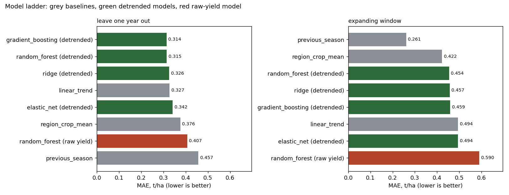
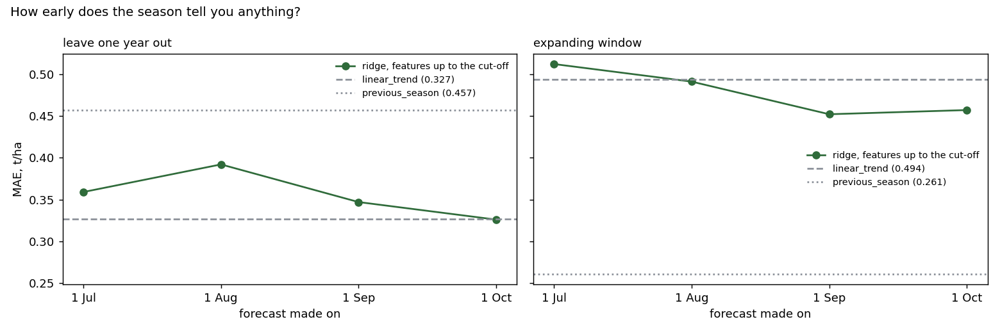
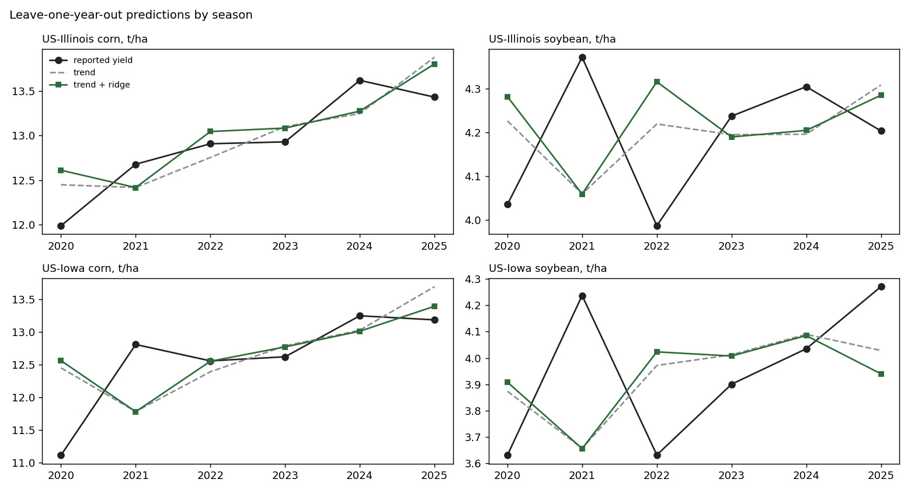

# Crop-yield model development

*Code: `src/features.py` and `src/yield_model_development.py`. Walkthrough with outputs: [`notebooks/crop_yield_model_development.ipynb`](../notebooks/crop_yield_model_development.ipynb).*

## Where this picks up

My [first experiment](crop-yield-season-experiment.md) settled the label question: growing-season features beat the winter rows. It left a bigger one open. The team's benchmark had found that no ML model beat simple baselines, and its findings named two next steps: an in-season version once a forecast cut-off was defined, and the warning that more labels would matter more than more features. Reading the team's setup, I noticed its models predicted the raw yield level. I wanted to see what a model could add once that was changed, with every choice made the way it would be in a real project.

## Setup

**Data.** The Gold candidate, 24 seasons (2 states x 2 crops x 2020 to 2025). Corn and soybean in the same state share every satellite and weather value, so there are really only 12 distinct feature rows behind the 24 labels.

**Target.** Each model predicts the season's relative gap to its own state-crop linear trend, fitted on the training years only. The prediction is `trend x (1 + predicted gap)`. Raw yield is mostly "corn or soybean" plus a slow climb, and simple baselines already capture both.

**Features.** Nine agronomic season features, built from windows that start in April and finish before a cut-off date:

| Feature | What it captures |
|---|---|
| `ndvi_peak`, `ndvi_peak_doy` | how green the canopy got, and when |
| `ndvi_integral` | accumulated green biomass over the season |
| `greenup_rate` | how fast the canopy developed |
| `gdd` | growing degree days above 10 °C |
| `hot_windows`, `tmax_avg` | heat stress |
| `precip_total` | water supply |
| `radiation_total` | light available for growth |

**Models,** each with a small grid ordered from simplest to most flexible:

- baselines: state-crop mean, previous season, linear trend
- on the detrended target: ridge, elastic net, random forest, gradient boosting
- for comparison: one random forest on the raw yield level, with crop, state and year as inputs

**Tuning.** Nested cross-validation. Hyperparameters are chosen by an inner leave-one-year-out loop that only sees the training years, so the test year never influences the choice. Ties go to the simpler setting.

**Splits.** Leave-one-year-out (retrospective, what the project used) and expanding window (train on earlier years only, test 2022 to 2025).

## Results

| Model | Target | MAE, leave-one-year-out | MAE, expanding window |
|---|---|---|---|
| gradient boosting | detrended | **0.314** | 0.459 |
| random forest | detrended | 0.315 | 0.454 |
| ridge | detrended | 0.326 | 0.457 |
| linear trend | baseline | 0.327 | 0.494 |
| elastic net | detrended | 0.342 | 0.494 |
| state-crop mean | baseline | 0.376 | 0.422 |
| random forest | raw yield | 0.407 | 0.590 |
| previous season | baseline | 0.457 | **0.261** |

MAE in t/ha. Full metrics, including RMSE and per-crop error, are in `results/model_dev_metrics.csv`.

**Detrending is the single biggest win.** The same random forest goes from 0.407 to 0.315 just by predicting the gap to trend instead of the raw yield, and from 0.590 to 0.454 under the expanding window.

**On top of the trend, features add a little, not a lot.** The best retrospective model, gradient boosting at 0.314, beats the trend by about 4%, with the random forest right behind (0.315). Ridge, once tuned without seeing the test year, lands almost exactly on the trend (0.326). The inner loop picks its strongest regularisation (alpha = 100) in 8 of 10 folds. That is the data saying it can't support much more than the trend.

**For a forecast, last year's yield still wins.** Ridge, random forest and gradient boosting all beat the trend under the expanding window (0.454 to 0.459 against 0.494), while elastic net shrinks all the way back to it. None gets near the previous-season baseline (0.261). The team reached the same conclusion with its own setup.

### Two feature sets on equal terms

The plain June to September averages from the first experiment, run through the same nested tuning:

| Feature set | Model | Leave-one-year-out | Expanding window |
|---|---|---|---|
| plain Jun-Sep averages | ridge | **0.294** | 0.480 |
| plain Jun-Sep averages | gradient boosting | 0.301 | 0.474 |
| agronomic season features | ridge | 0.326 | **0.457** |
| agronomic season features | gradient boosting | 0.314 | 0.459 |

Neither set wins everywhere. The simpler averages do better retrospectively, and the agronomic features do better in the forecast-style split. Both beat the trend; neither beats last year's yield. With 24 seasons, differences of 0.01 to 0.03 t/ha between feature sets are within noise.

This also puts an earlier number in context. The first experiment gets 0.265 for ridge on the plain averages with alpha fixed at 1. Tuned without seeing the test year, the same model scores 0.294: still ahead of the trend, but by less.

### In-season forecasts

| Forecast made on | Leave-one-year-out | Expanding window |
|---|---|---|
| 1 July (5-6 windows) | 0.359 | 0.512 |
| 1 August (7-8) | 0.392 | 0.491 |
| 1 September (9-10) | 0.347 | 0.452 |
| 1 October (11-12) | 0.326 | 0.457 |
| linear trend, for reference | 0.327 | 0.494 |

The season only starts to help late. Under leave-one-year-out the in-season model never gets meaningfully ahead of the trend; its best is 0.326 against 0.327 on 1 October. Under the expanding window it's level with the trend on 1 August and clearly ahead from 1 September, once the canopy peak is in the data.

### What the ridge model leans on

| Feature | Coefficient, % of trend yield per SD | Same sign across folds | MAE change if dropped |
|---|---|---|---|
| `ndvi_peak` | -0.13 | 100% | **+0.035** |
| `ndvi_integral` | -0.04 | 83% | +0.004 |
| `greenup_rate` | -0.06 | 83% | +0.002 |
| `ndvi_peak_doy` | +0.17 | 100% | -0.003 |
| `radiation_total` | -0.09 | 83% | -0.005 |
| `tmax_avg` | +0.29 | 83% | -0.006 |
| `precip_total` | -0.01 | 67% | -0.011 |
| `hot_windows` | +0.17 | 67% | -0.011 |
| `gdd` | +0.10 | 83% | -0.013 |

Only peak NDVI clearly earns its place, and even then the coefficients are fractions of a percent of yield. Some signs run against agronomic intuition: more heat comes out as slightly *above*-trend yield. I read this as the model fitting noise around the trend rather than learning crop physiology. With 12 distinct feature rows, that's what you'd expect.

### Where the errors are

Under leave-one-year-out, the biggest miss for every model is **Iowa corn 2020**: 1.34 t/ha for the trend, 1.45 for ridge. That was the season of the August derecho, which flattened corn across central Iowa right around the canopy peak, on top of a dry summer. A statewide 16-day NDVI mean barely registers damage like that. The features help most on Iowa corn in 2025 (error 0.51 down to 0.21) and 2022 (0.17 down to 0.01). The full table is in `results/model_dev_errors_by_season.csv`.

### Sensitivity

The project had flagged Iowa soybean 2022 as a possible census/survey mix-up. Without that season (23 rows, leave-one-year-out), the ranking holds: gradient boosting 0.314, random forest 0.330, ridge 0.331, trend 0.337.

## Model card

| | |
|---|---|
| **Task** | Season-level yield for corn and soybean in Iowa and Illinois, in t/ha |
| **Best retrospective model** | Gradient boosting on the gap to trend, MAE 0.314 (leave-one-year-out) |
| **Best forecast-style model** | Previous season's yield, MAE 0.261 (expanding window) |
| **Training data** | 24 seasons from the Gold candidate, 2020 to 2025 |
| **Intended use** | Learning and benchmarking. Not an operational forecast |
| **Known limits** | 12 distinct feature rows; regional features that can't tell the crops apart; three 2022 yields that differ between data snapshots; sudden damage such as wind or hail isn't visible at this resolution |
| **What would change the picture** | County-level yields (about 200 counties across the two states), a crop mask so features become crop-specific, and more years |

## Why no deep learning

A sequence model or a CNN over the 16-day series would have 24 labels to learn from and 12 distinct inputs. It would memorise them. At this scale the sensible choice is regularised models, nested tuning and baselines that are hard to beat. Deep models make sense once the labels move to county level.
