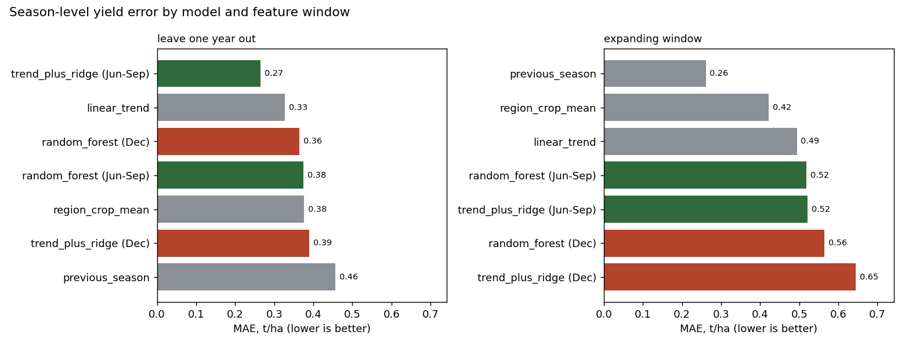

# Crop yield: does the growing season beat the winter rows?

*Code: `src/season_yield_baselines.py`. Walkthrough with outputs: [`notebooks/crop_yield_season_experiment.ipynb`](../notebooks/crop_yield_season_experiment.ipynb).*

## Why I ran it

In Sprint 1 I found that the yield label sat on post-harvest December and January rows, and proposed joining it to the June to September windows instead ([label write-up](yield-and-land-use-labels.md)). A design argument isn't proof, so I built this experiment to see whether that choice changes what a model learns.

## Setup

- **Data:** the Gold dataset candidate (580 rows x 81 columns, 2020 to 2025).
- **Unit:** one row per season, (region, crop, year). That's 24 rows: 2 states x 2 crops x 6 years.
- **Features,** built twice in the same way:
  - `growing`: windows starting June to September (8 or 9 per season)
  - `post_harvest`: windows starting in December (1 or 2 per season), roughly where the label used to sit
  - six per season: average and peak NDVI, average SAVI, average daily max temperature, total precipitation, total solar radiation
- **Models,** simplest first:
  - `region_crop_mean`: average yield for that state and crop in the training years
  - `previous_season`: last year's yield for the same state and crop
  - `linear_trend`: straight-line trend per state and crop
  - `trend_plus_ridge`: the trend, plus a ridge model on the season features that explains the relative gap to trend (alpha fixed at 1.0 before running)
  - `random_forest`: shallow forest (depth 3) on the features plus crop, state and year
- **Splits:**
  - leave-one-year-out, which is what the project used; it's retrospective, since later years help predict earlier ones
  - expanding window: train only on earlier years, test 2022 to 2025; this is closer to how a forecast would actually be used
- **Metric:** MAE in t/ha, overall and per crop. Corn yields sit around 11 to 13.6 t/ha and soybean around 3.6 to 4.4, so R² rewards any model that just knows the crop. I left it out.

## Results

**Leave-one-year-out** (24 predictions)

| Model | Features | MAE | RMSE | MAE corn | MAE soybean |
|---|---|---|---|---|---|
| trend_plus_ridge | Jun-Sep | **0.265** | 0.368 | 0.295 | 0.234 |
| linear_trend | none | 0.327 | 0.441 | 0.441 | 0.213 |
| random_forest | Dec | 0.365 | 0.513 | 0.520 | 0.209 |
| random_forest | Jun-Sep | 0.375 | 0.512 | 0.468 | 0.282 |
| region_crop_mean | none | 0.376 | 0.559 | 0.542 | 0.209 |
| trend_plus_ridge | Dec | 0.390 | 0.518 | 0.563 | 0.217 |
| previous_season | none | 0.457 | 0.651 | 0.618 | 0.296 |

**Expanding window** (16 predictions, 2022 to 2025)

| Model | Features | MAE | RMSE | MAE corn | MAE soybean |
|---|---|---|---|---|---|
| previous_season | none | **0.261** | 0.332 | 0.267 | 0.256 |
| region_crop_mean | none | 0.422 | 0.514 | 0.666 | 0.178 |
| linear_trend | none | 0.494 | 0.701 | 0.648 | 0.340 |
| random_forest | Jun-Sep | 0.519 | 0.659 | 0.637 | 0.401 |
| trend_plus_ridge | Jun-Sep | 0.521 | 0.701 | 0.642 | 0.400 |
| random_forest | Dec | 0.565 | 0.685 | 0.722 | 0.408 |
| trend_plus_ridge | Dec | 0.645 | 0.842 | 0.856 | 0.434 |

Since I'd fixed alpha at 1.0 without tuning, I also checked the ridge comparison at other values:

| Split | Features | alpha 0.3 | 1 | 3 | 10 |
|---|---|---|---|---|---|
| leave-one-year-out | Jun-Sep | 0.297 | 0.265 | 0.244 | 0.252 |
| leave-one-year-out | Dec | 0.432 | 0.390 | 0.366 | 0.341 |
| expanding window | Jun-Sep | 0.582 | 0.521 | 0.465 | 0.418 |
| expanding window | Dec | 0.654 | 0.645 | 0.614 | 0.553 |

## What I take from it

1. **The growing season matters, as long as the model has a trend to lean on.** Under leave-one-year-out, trend plus June to September features is the best model and beats the plain trend (0.265 vs 0.327). The same model fed December features does worse than the plain trend. Growing-season features beat December ones in three of the four model and split pairs, and the ridge gap holds at every alpha I tried.
2. **For a real forecast, last year's yield is very hard to beat.** Under the expanding window, nothing beats `previous_season` (0.261). With two to five years of history, a trend line fitted on so few points is unstable and a feature model has almost nothing to learn from. The project team reached the same conclusion in its own benchmark: simple baselines held up against every ML model it tried.
3. **24 points produce convincing-looking noise.** The strongest single correlation with the yield gap is December temperature (0.58). Winter temperature has no business explaining the previous summer's harvest, so I read that as chance and as a reason not to trust any one feature here.

## Caveats

- 24 seasons is a small sample, and every result here should be read with that in mind.
- The satellite and weather features are regional and identical for corn and soybean, so they can't explain why one crop did better than the other in the same state.
- Three 2022 yields differ between the Gold candidate and the earlier interim table (Illinois corn 12.91 vs 13.43 t/ha, Illinois soybean 3.99 vs 4.24, Iowa soybean 3.63 vs 3.93). The project had a known open issue on 2022 values. I used the Gold values as they were.
- This is retrospective. Nothing here is an in-season forecast with a cut-off date.

## Tuning without seeing the test year

Alpha was fixed at 1.0 here, chosen before running but not tuned. When I let an inner cross-validation loop pick it on the training years only, the same ridge model on the same features scores 0.294 under leave-one-year-out. That's still ahead of the trend's 0.327, but by less than 0.265 suggested.

That tuning, along with detrended targets, agronomic features, in-season cut-offs and error analysis, is in [crop-yield-model-development.md](crop-yield-model-development.md).
