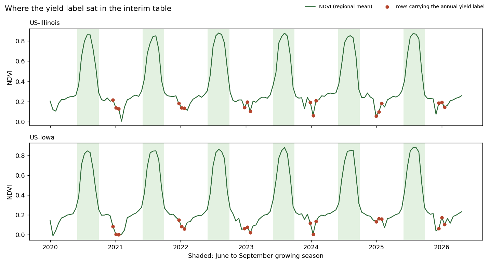

# Yield and land-use labels: how they get built

*Written during Sprint 1, cleaned up for this repo. Every number here can be reproduced with `src/audit_yield_label.py`.*

## Short version

The two labels were in very different states.

Yield had a usable target, `yield_tonnes_per_ha`, with 24 real annual observations. But the way it was stored didn't line up with the growing season that produced it, and that needed fixing before anyone trained on it.

Land use had nothing: no label, no proxy, not even the schema field it was supposed to come from. Everything in the land-use section is a proposal, and I've tried to keep it obvious which parts are facts and which are recommendations.

## What I worked from

The team had already shortlisted candidate targets, and the data team had mapped where those targets clashed with the schema. I took those conclusions as given and worked on the layer underneath: where each label physically comes from, which row it has to land on, and when it's safe to use.

Dataset: `master_dataset.csv`, 580 rows x 154 columns, SHA-256 `5b3e8a1c…c03f7`. I reran the hash myself before starting rather than trusting the figure quoted in the review I was building on. It matched.

## The yield label

### What was usable and what wasn't

`yield_tonnes_per_ha` was the target. `production_tonnes` stayed out. It failed production = yield x area by a factor that changed with the crop and drifted by year: corn averaged 4.99x (4.1x to 6.5x across years), soybean 11.90x (10.1x to 14.3x). A ratio that moves like that isn't a simple unit mismatch, so it couldn't be patched with a constant.

The grain was (region, crop, season year): 2 regions x 2 crops x 6 years (2020 to 2025) = 24 observations. Nothing existed at county level.

### How it got into the table

The table didn't store each annual yield once. It copied it onto three window rows: the window containing the report's release date (tagged `release_window`) and the next two windows (tagged `release_window_forward_fill`). I checked all 72 labelled rows. Every one of the 24 annual values showed up exactly three times.

### The part that needed fixing

None of those three windows fell anywhere near the growing season.

I grouped the 72 labelled rows by season and looked at when their windows started. Every one sat between mid-December of the season year and late January of the next: 24 rows in December, 48 in January, none in June to September.

So a benchmark reading `yield_tonnes_per_ha` off the same row as its satellite and weather columns would pair each yield with post-harvest, winter readings, not with anything that grew the crop. This wasn't a leakage problem; the growing-season windows all came before the release date and were fine as predictors. The label and the features were simply sitting on the wrong rows.

**My proposal:** stop treating the label as something that lives on a window row. Store it as its own record, (region, crop, season year, release date), and join it to an aggregate of that year's June to September windows when the Gold table is built. How to aggregate (mean, peak, end-of-season) was left as a separate decision.

### Sampling and leakage

Because each label was copied three times, the window row couldn't be the unit to train or score on. The season had to be. Otherwise 24 labels would quietly become 72 and the sample would look three times bigger than it was.

I recommended keying splits on release date, keeping them chronological, and lagging any rolling feature by one window. Every report was an `ESTIMATE` at the time, so there was no forecast-vs-final distinction yet; that would change as soon as a forecast record showed up.

### Still uncertain

- 24 seasons was the real sample size, whatever the row count said.
- `production_tonnes` could come back if it was reconciled against the USDA source. It was parked, not dropped.
- The June to September join was my proposal and hadn't been validated. (I tested it in [crop-yield-season-experiment.md](crop-yield-season-experiment.md).)

## The land-use label

### Starting point: there wasn't one

No label and no proxy in any of the 154 columns. `band_scl` (the Sentinel-2 scene classification layer) was declared required in the schema and simply wasn't in the data. The first phase of the project never got a land-use model working at all.

### Where the label would come from

The USDA NASS Cropland Data Layer (CDL). One addition: every row built from it would need its own `cdl_year`, kept separate from `season_year`. A CDL product's publish year and the crop year it maps aren't guaranteed to match, and the same kind of gap had already been flagged on the satellite side with the crop mask year.

### What the classes would be

There was no taxonomy anywhere, so I proposed a short one instead of adopting CDL's full legend: corn, soybean, other cropland, grassland/pasture, forest, water, developed/urban, and a catch-all. Most CDL classes don't apply to a two-crop, two-state benchmark, and pulling them all in would have added noise to an already thin label. I deliberately didn't hard-code CDL's numeric codes; that legend gets republished each year, so I left the crosswalk to be built and version-pinned at ingestion.

### State or county

County was what I recommended, because at state level almost all the crop-rotation signal disappears. If county extraction didn't make it into scope, the fallback was a state-level share, area-weighted across its counties, reported with wider uncertainty.

### Regression, not classification

The schema framed land use as classification, fused with soil, climate and historical land records. I didn't carry that forward. None of those extra inputs existed in any source, and a "did the dominant crop change" label hardly ever flips from one year to the next, so one class would dominate before training even started.

My recommendation was continuous share regression:

| Target | Type | Role |
|---|---|---|
| `crop_area_share` | continuous | primary |
| `crop_area_share_delta` | continuous | the year-over-year "change" the task asks for |
| `change_magnitude` | continuous | rougher secondary summary |
| `dominant_transition_class` | categorical | not recommended |

### When it would be safe to use

With no CDL ingestion there was no real publish date to check against, so I applied the yield rule by analogy: the label for crop year Y would record CDL's actual publication date and only become usable after it.

### If CDL didn't happen

The only fallback in the schema was `band_scl`, once it existed. But SCL is built for cloud and atmosphere masking, not crop identification, so a class share derived from it would be much less trustworthy. I recorded it so the option wasn't lost, not as something to use without separate validation.

## One thing that affected both labels

Satellite and weather values were identical for corn and soybean in the same region and window. I checked all 290 region-window pairs across 117 columns: zero cells differed. Until a crop mask existed, both labels would be modelled against regional signal, not anything crop-specific. That was a real limitation, and I wanted the methodology to say so upfront.

It also meant cross-validation folds had to be grouped by (region, window). Otherwise the corn and soybean copies of the same features would end up on both sides of the split.

## Where things stood

| Solid, grounded in the data | Still open at the time |
|---|---|
| `yield_tonnes_per_ha` as the target; `production_tonnes` out | Growing-season join window and aggregation |
| Each label copied onto 3 rows (release window + 2 forward fills) | State or county for land use |
| Labelled windows never touched the growing season | Whether CDL gets adopted, and how often |
| The season, not the row, as the scoring unit | Formal sign-off on share regression |
| No land-use label or proxy existed | Whether `production_tonnes` comes back |
| Satellite and weather features were crop-agnostic | Land-use availability rule (borrowed from yield) |

## What happened next

When the Gold dataset candidate arrived in Sprint 3, each annual yield was attached to every window of its season year, so the growing-season windows finally sat on labelled rows. The trade-off was that the label became visible on windows dated before its release, which is fine for a retrospective benchmark and a leak for any in-season forecast. The team treated it as a known caveat.

Land use never got its label. The imagery and labels it needed didn't arrive before the project closed, and it was handed over as a future track.
